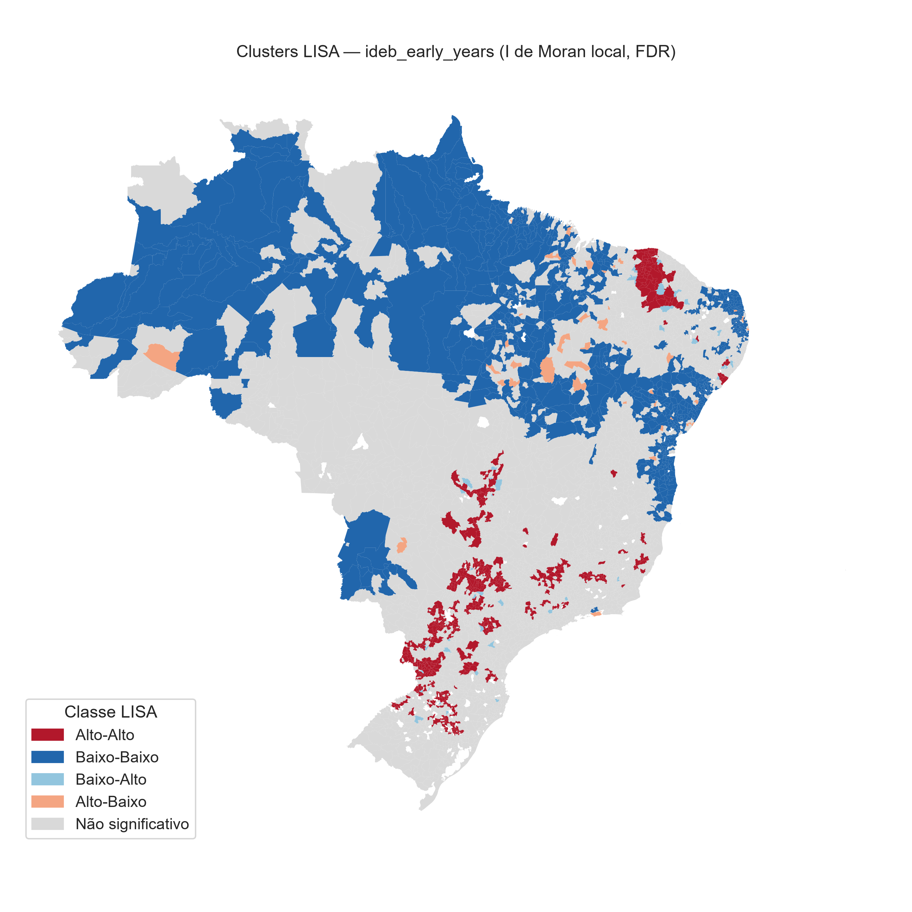
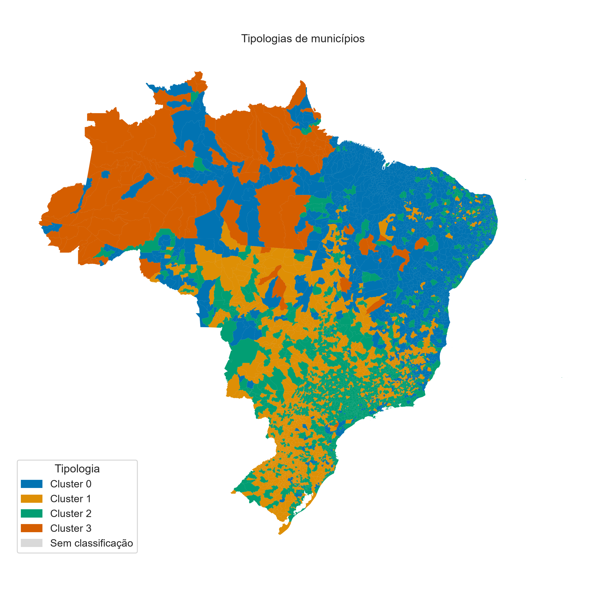

# 🎓 Radar da Educação Municipal

[](https://github.com/luanfreitas5/radar-educacao-municipal/actions/workflows/ci.yml)
[](https://github.com/luanfreitas5/radar-educacao-municipal/actions/workflows/tests.yml)
[](https://codecov.io/gh/luanfreitas5/radar-educacao-municipal)
[](https://luanfreitas5.github.io/radar-educacao-municipal/)

[](LICENSE)

Integra **Censo Escolar**, **IDEB** e dados do **IBGE** por município e identifica
**tipologias de municípios** com **análise espacial** (I de Moran e LISA).

## 🧭 Problema

Os 5.570 municípios brasileiros diferem muito em infraestrutura escolar, porte e renda,
e as políticas educacionais costumam tratá-los como um bloco homogêneo (ou apenas por UF).
Falta uma visão integrada que mostre **quais perfis de município existem**, **como o IDEB
se distribui entre eles** e **se esses perfis ocupam o território de forma agrupada**.

## ❓ Pergunta

1. Que tipologias de município emergem de infraestrutura escolar e contexto socioeconômico?
2. O IDEB — que **não** entra na clusterização — difere entre as tipologias (e com que magnitude)?
3. O IDEB e as tipologias apresentam **autocorrelação espacial**? Onde estão os aglomerados
   Alto-Alto e Baixo-Baixo?

## 📦 Dados

| Fonte | Conteúdo | Chave |
|---|---|---|
| [Censo Escolar (INEP)](https://www.gov.br/inep/pt-br/acesso-a-informacao/dados-abertos/microdados/censo-escolar) | infraestrutura, matrículas e docentes (escola → município) | `CO_MUNICIPIO` |
| [IDEB (INEP)](https://www.gov.br/inep/pt-br/areas-de-atuacao/pesquisas-estatisticas-e-indicadores/ideb) | nota observada, anos iniciais e finais, rede pública | `CO_MUNICIPIO` |
| [SIDRA (IBGE)](https://sidra.ibge.gov.br/) | população, área (tab. 4714) e PIB (tab. 5938) | código do município |
| [geobr](https://github.com/ipeaGIT/geobr) | malha municipal e UF | `code_muni` |

Chave de junção: **código IBGE de 7 dígitos** (`code_muni`), validado por contrato de dados.
Detalhes e cuidados em [docs/data_sources.md](docs/data_sources.md) e no
[datasheet](reports/datasheets/datasheet_base_municipal.md). **Os dados brutos não são
versionados no Git**: `make ingest` os baixa para `data/bronze/` com cache e hash.

## 🔬 Método

```
ingestão ► bronze ► silver (agregado + contrato) ► gold (junção + integridade)
        ► KMeans + UMAP + perfil ► Queen + Moran + LISA ► relatório
```

1. **Ingestão idempotente** com cache local e `manifest.json` (URL, SHA-256, data).
2. **Agregação por município** e junção à esquerda sobre a malha do IBGE, com testes de
   integridade (cobertura mínima por fonte, duplicatas, chaves órfãs e fração de nulos).
3. **Clusterização:** `log1p` nas variáveis assimétricas → padronização → k por silhouette
   → KMeans → estabilidade por subamostragem (ARI) → UMAP *apenas* para visualização →
   perfil por cluster com IC 95% bootstrap do IDEB e teste de Kruskal-Wallis (com ε²).
4. **Análise espacial:** vizinhança Queen (ilhas removidas), I de Moran global, LISA com
   permutações e correção FDR (Benjamini-Hochberg), mapa de clusters LISA e coesão
   territorial das tipologias.
5. **Relatório** automático em `reports/relatorio.md`.

## 🚀 Como reproduzir

Requisitos: [uv](https://docs.astral.sh/uv/), Python 3.10+ e ~2 GB livres em disco.

```bash
git clone https://github.com/luanfreitas5/radar-educacao-municipal.git
cd radar-educacao-municipal
make init          # uv sync + hooks do pre-commit
make reproduce     # ingest → silver → gold → cluster → spatial → report
```

Etapas individuais: `make ingest`, `make silver`, `make gold`, `make cluster`,
`make spatial`, `make report`. Qualidade e testes: `make check` (espelha o CI).
Anos de referência, URLs e hiperparâmetros ficam em [`configs/`](configs/), validados com
Pydantic na inicialização.

> ⚠️ O INEP reorganiza os caminhos de download com frequência. Se `make ingest` retornar 404,
> atualize a URL em `configs/data_sources.yaml`. Os nomes das colunas do Censo Escolar
> seguem o dicionário de dados do ano de referência; mudanças são detectadas com erro
> explicativo.

## 📊 Resultados

Números gerados por `make reproduce` e registrados em
[`reports/results.json`](reports/results.json) e [`reports/relatorio.md`](reports/relatorio.md);
figuras em `reports/figures/` (PNG 300 dpi + SVG). SHA-256 da base gold:
`3eb86d80…a71d3`.

**Resumo:** quatro tipologias estáveis (ARI 0,98), com IDEB claramente diferente entre
elas (ε² ≈ 0,19–0,24) e forte autocorrelação espacial do IDEB (I de Moran ≈ 0,59–0,63).

### Integridade da base

5.570 municípios, 0 chaves duplicadas, 0 chaves órfãs. Cobertura: Censo Escolar, população
e PIB per capita 100%; IDEB anos iniciais 97,5% e anos finais 96,6%.

### Tipologias (KMeans, k = 4)

- k escolhido por silhouette (0,189; k = 3: 0,173, k = 5: 0,146). O valor é **baixo**: os
  grupos se sobrepõem e devem ser lidos como perfis, não como categorias bem separadas.
- Estabilidade por subamostragem (30 repetições): ARI = **0,98** [IC 95%: 0,95; 0,99].

| Cluster | Municípios | Perfil (z-score da mediana) | IDEB anos iniciais (mediana, IC 95%) | IDEB anos finais (mediana, IC 95%) |
|---|---|---|---|---|
| 0 | 1.981 (36%) | mais rural, rede municipal, poucos laboratórios de informática | 5,2 [5,1; 5,2] | 4,3 [4,3; 4,4] |
| 1 | 1.952 (35%) | água encanada, menos alunos por docente, mais bibliotecas | 6,2 [6,2; 6,3] | 5,1 [5,0; 5,1] |
| 2 | 1.526 (27%) | urbano, esgotamento sanitário, escolas maiores | 6,1 [6,1; 6,2] | 5,0 [5,0; 5,0] |
| 3 | 111 (2%) | infraestrutura crítica: energia (−5,9), internet (−3,9), água (−2,5); os municípios com IDEB estão todos na região Norte | 4,6 [4,3; 4,8] | 3,9 [3,8; 4,2] |

O IDEB **não entra** na clusterização, e ainda assim difere entre os grupos
(Kruskal-Wallis, anos iniciais: H = 1324,8, p ≈ 6e-287, ε² = 0,24, n = 5.430; anos finais:
H = 1045,1, p ≈ 3e-226, ε² = 0,19, n = 5.382). Efeito grande, mas ε² mede associação,
não causalidade. Os clusters 1 e 2 têm IDEB quase idêntico: o que os separa é o perfil
urbano/rural, não o desempenho. Por região, a ordem entre clusters se mantém, mas o nível
varia mais por região do que entre clusters 1 e 2 (ex.: anos iniciais no cluster 2, Sul 6,2
vs. Nordeste 5,4) — ver `median_by_region` em `results.json`.

### Análise espacial (Queen, 999 permutações, FDR)

| Variável | I de Moran | z | p | n |
|---|---|---|---|---|
| IDEB anos iniciais | **0,625** | 76,7 | 0,001 | 5.428 |
| IDEB anos finais | **0,591** | 68,8 | 0,001 | 5.380 |

(p = 0,001 é o mínimo possível com 999 permutações.)

| LISA (FDR) | Alto-Alto | Baixo-Baixo | Alto-Baixo | Baixo-Alto | Não signif. |
|---|---|---|---|---|---|
| Anos iniciais | 575 | 818 | 39 | 43 | 3.953 |
| Anos finais | 538 | 628 | 32 | 13 | 4.169 |

Os aglomerados Baixo-Baixo são mais numerosos que os Alto-Alto nas duas etapas. As
tipologias também são **territorialmente coesas**: a fração de vizinhos no mesmo cluster
é 1,7× a 2,0× a esperada ao acaso nos clusters 0–2 e **30,7×** no cluster 3 (observada
0,61 vs. 0,02 esperada), isto é, os municípios de infraestrutura crítica formam um bloco
geográfico contíguo.




> Não há baseline preditivo nem modelo supervisionado: o estudo é descritivo/exploratório.
> Cobertura de IDEB menor que 100% e a baixa silhouette são as principais ressalvas.

## ⚠️ Limitações

- Análise **municipal**: não se aplica diretamente a escolas ou estudantes (falácia ecológica).
- **Associação, não causalidade**: o IDEB difere entre tipologias, mas nada aqui estima efeitos.
- Anos de referência diferentes entre fontes (ex.: PIB 2021 dividido pela população 2022).
- IDEB ausente em municípios pequenos pode enviesar a comparação do desfecho.
- KMeans supõe grupos esféricos; o k por silhouette favorece poucos grupos. O UMAP é só ilustrativo.
- Queen e ilhas removidas: o tamanho irregular dos municípios afeta a vizinhança (MAUP).
- LISA aponta associação espacial local, não a causa dos aglomerados.

Lista completa e discussão no relatório gerado.

## 🗂️ Estrutura

```
configs/        YAML validados (config, paths, logging, data_sources, model_params)
data/           bronze (imutável) · silver · gold — fora do Git
src/            config · ingestion · preprocessing · schemas · validation ·
                modeling · spatial · visualization · reporting · pipelines · main.py
tests/          unitários, propriedades (hypothesis), comportamentais e integração
notebooks/      exploração e apresentação (sem lógica de produção)
reports/        relatório, figuras, datasheet
docs/           MkDocs Material + API gerada das docstrings
```

## 🛠️ Convenções

Python 3.10+ com `uv` · Polars no lugar de pandas (pandas só onde geopandas/esda exigem) ·
identificadores em inglês, docstrings NumPy em pt-BR · `ruff`, `basedpyright`, `pytest`
(≥ 80% de cobertura) e `pre-commit` · Conventional Commits.

## 📄 Licença

[MIT](LICENSE) © Luan Freitas
