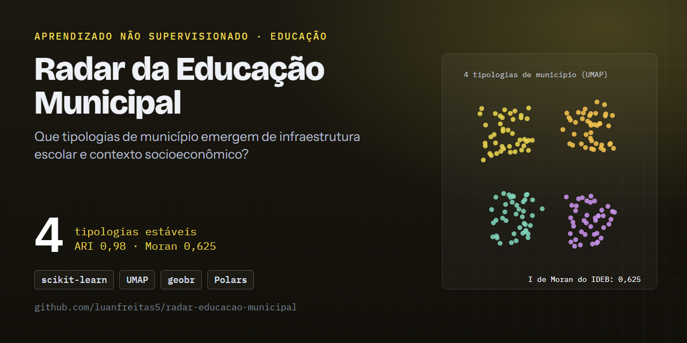

# 🎓 Radar da Educação Municipal: 4 tipologias estáveis de municípios e um IDEB espacialmente agrupado

[](https://github.com/luanfreitas5/radar-educacao-municipal/actions/workflows/ci.yml)
[](https://codecov.io/gh/luanfreitas5/radar-educacao-municipal)
[](https://luanfreitas5.github.io/radar-educacao-municipal/)
[](LICENSE)
 <!-- = matriz do CI (tests.yml) -->



> **Resultado:** KMeans (k = 4) sobre infraestrutura escolar e contexto socioeconômico de **5.570 municípios** produz tipologias estáveis (**ARI = 0,98, IC 95%: 0,95–0,99**) que diferem no IDEB, variável fora da clusterização (Kruskal-Wallis ε² = **0,24**, anos iniciais), e o IDEB tem forte autocorrelação espacial (**I de Moran = 0,625**, p = 0,001). **Não há baseline preditivo:** o estudo é descritivo; a silhouette é baixa (**0,189**), então os grupos são perfis sobrepostos, não categorias nítidas.

## 🎯 Problema

- **Quem decide o quê:** analistas e gestores de política educacional que hoje tratam os municípios como um bloco homogêneo (ou apenas por UF) e precisam saber **quais perfis existem**, **como o IDEB se distribui entre eles** e **se ocupam o território de forma agrupada**.
- **Custo dos erros:** não há decisão automática; o risco é ler fronteiras difusas como categorias nítidas ou associação como causa → **métricas principais:** silhouette (escolha de k), ARI (estabilidade) e ε² (efeito sobre o IDEB), reportadas com IC.
- **Unidade de análise e referência temporal:** uma linha por município; Censo Escolar e IDEB 2023, população 2022, PIB 2021. O IDEB **não** entra na clusterização: é o desfecho externo.

## 🗂️ Dados

| Item | Valor |
|---|---|
| Fonte e licença | [Censo Escolar](https://www.gov.br/inep/pt-br/acesso-a-informacao/dados-abertos/microdados/censo-escolar) e [IDEB](https://www.gov.br/inep/pt-br/areas-de-atuacao/pesquisas-estatisticas-e-indicadores/ideb) (INEP), [SIDRA](https://sidra.ibge.gov.br/) (IBGE), [geobr](https://github.com/ipeaGIT/geobr) (IBGE/IPEA) — dados abertos |
| Tamanho / período | 5.570 municípios, 24 colunas; referência 2021–2023 |
| Alvo e prevalência | sem rótulo supervisionado; IDEB disponível em 97,5% (anos iniciais) e 96,6% (anos finais) dos municípios |
| Chave de junção | código IBGE de 7 dígitos (`code_muni`), validado por contrato `pandera`; 0 duplicatas, 0 órfãs |
| Documentação | [Datasheet](reports/datasheets/datasheet_base_municipal.md) · [docs/data_sources.md](docs/data_sources.md) |

Os dados brutos **não são versionados**: `make ingest` os baixa para `data/bronze/` com cache e hash SHA-256 (`manifest.json`).

## 📊 Resultados

Protocolo: sem split (modelo não supervisionado, avaliação interna), seed 42; IC por bootstrap (2.000 reamostragens) para o IDEB e 30 subamostras de 80% para o ARI. Números de [`reports/results.json`](reports/results.json) e [`reports/relatorio.md`](reports/relatorio.md); SHA-256 da base gold: `3eb86d80…a71d3`.

**Escolha de k e estabilidade**

| k | Silhouette |
|---|---|
| 3 | 0,173 |
| **4** | **0,189** |
| 5 | 0,146 |

ARI por subamostragem: **0,98** (IC 95%: 0,95–0,99, 30 repetições). A silhouette é **baixa**: os grupos se sobrepõem e devem ser lidos como perfis.

**Tipologias (IDEB: mediana e IC 95% bootstrap)**

| Cluster | Municípios | Perfil (z-score da mediana) | IDEB anos iniciais | IDEB anos finais |
|---|---|---|---|---|
| 0 | 1.981 (36%) | mais rural, rede municipal, poucos laboratórios de informática | 5,2 [5,1; 5,2] | 4,3 [4,3; 4,4] |
| 1 | 1.952 (35%) | água encanada, menos alunos por docente, mais bibliotecas | 6,2 [6,2; 6,3] | 5,1 [5,0; 5,1] |
| 2 | 1.526 (27%) | urbano, esgotamento sanitário, escolas maiores | 6,1 [6,1; 6,2] | 5,0 [5,0; 5,0] |
| 3 | 111 (2%) | infraestrutura crítica: energia (−5,9), internet (−3,9), água (−2,5); IDEB só na região Norte | 4,6 [4,3; 4,8] | 3,9 [3,8; 4,2] |

- **Diferença entre clusters (Kruskal-Wallis):** anos iniciais H = 1324,8, p ≈ 6e-287, ε² = 0,24 (n = 5.430); anos finais H = 1045,1, p ≈ 3e-226, ε² = 0,19 (n = 5.382). Efeito grande, mas ε² mede associação, não causalidade.
- **Pior segmento:** cluster 3 (IDEB 4,6 / 3,9), concentrado no Norte. Os clusters 1 e 2 têm IDEB quase idêntico: o que os separa é o perfil urbano/rural. O nível varia mais por região que entre eles (anos iniciais no cluster 2: Sul 6,2 vs. Nordeste 5,4). Ver o [Model Card](reports/model_cards/tipologia_kmeans_v1.md).

**Análise espacial (Queen, 999 permutações, FDR)**

| Variável | I de Moran | z | p | n |
|---|---|---|---|---|
| IDEB anos iniciais | **0,625** | 76,7 | 0,001 | 5.428 |
| IDEB anos finais | **0,591** | 68,8 | 0,001 | 5.380 |

(p = 0,001 é o mínimo possível com 999 permutações.)

| LISA (FDR) | Alto-Alto | Baixo-Baixo | Alto-Baixo | Baixo-Alto | Não signif. |
|---|---|---|---|---|---|
| Anos iniciais | 575 | 818 | 39 | 43 | 3.953 |
| Anos finais | 538 | 628 | 32 | 13 | 4.169 |

Os aglomerados Baixo-Baixo superam os Alto-Alto nas duas etapas. As tipologias são **territorialmente coesas**: a fração de vizinhos no mesmo cluster é 1,7× a 2,0× a esperada ao acaso nos clusters 0–2 e **30,7×** no cluster 3 (0,61 observada vs. 0,02 esperada).


## 🔁 Reproduzir

Requisitos: [uv](https://docs.astral.sh/uv/), `make`, Python 3.10+ e ~2 GB livres em disco. Não há credenciais (todas as fontes são públicas). Tempo: TODO — medir um `make reproduce` completo (depende do download do INEP).

```bash
git clone https://github.com/luanfreitas5/radar-educacao-municipal.git
cd radar-educacao-municipal
```

<!-- verify:start -->
```bash
uv sync --locked
make reproduce   # ingest → silver → gold → cluster → spatial → report
```
<!-- verify:end -->

Saída esperada: `reports/results.json` com `k = 4`, `silhouette ≈ 0,189` e hash gold `3eb86d80…`. Ambiente que gerou os números publicados: TODO — registrar versão do Python e commit do `uv.lock` (versões diferentes podem resolver wheels distintas e deslocar métricas). Etapas individuais: `make ingest`, `make silver`, `make gold`, `make cluster`, `make spatial`, `make report`. Qualidade: `make check` (espelha o CI). Anos de referência, URLs e hiperparâmetros ficam em [`configs/`](configs/), validados com Pydantic na inicialização.

> ⚠️ O INEP reorganiza os caminhos de download com frequência. Se `make ingest` retornar 404, atualize a URL em `configs/data_sources.yaml`.

## 🧱 Estrutura

```
configs/        YAML validados (config, paths, logging, data_sources, model_params)
data/           bronze (imutável) · silver · gold — fora do Git
src/            config · ingestion · preprocessing · schemas · validation ·
                modeling · spatial · visualization · reporting · pipelines · main.py
tests/          unitários, propriedades (hypothesis), comportamentais e integração
reports/        relatorio.md, results.json, figures/, model_cards/, datasheets/
docs/           MkDocs Material + API gerada das docstrings
```

Decisões de método que justificam o código: `log1p` + padronização antes do KMeans (variáveis assimétricas); k por silhouette com estabilidade por ARI; UMAP **apenas** para visualização; vizinhança Queen com LISA corrigido por FDR (Benjamini-Hochberg); Polars no lugar de pandas (pandas só onde geopandas/esda exigem); `pandera` como contrato de dados em cada camada.

## ⚠️ Limitações

- Análise **municipal**: não se aplica a escolas ou estudantes (falácia ecológica).
- **Associação, não causalidade**: nada aqui estima efeito de infraestrutura sobre o IDEB.
- Silhouette baixa (0,189); KMeans supõe grupos esféricos e o k por silhouette favorece poucos grupos.
- Anos de referência diferentes entre fontes (PIB 2021 dividido pela população 2022); IDEB ausente em municípios pequenos pode enviesar o desfecho.
- Validação apenas interna; IC 95% por região × cluster ainda não calculado (TODO no Model Card).
- Queen e ilhas removidas: tamanho irregular dos municípios afeta a vizinhança (MAUP); LISA aponta associação local, não a causa.

Lista completa em [`reports/relatorio.md`](reports/relatorio.md).

## 📄 Licença e citação

MIT — ver [LICENSE](LICENSE) © Luan Freitas. Não há artigo associado, portanto não há `CITATION.cff`.
